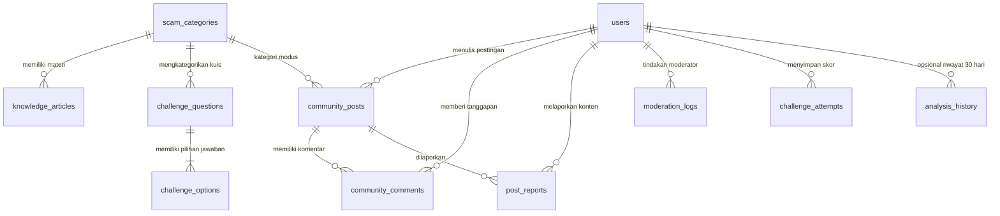

# Dokumentasi Skema Basis Data - Scamora AI

Platform Pendeteksi Potensi Penipuan Digital Berbasis AI (**MIT-Week 2026 Innovation Challenge**)  
Target Basis Data: **PostgreSQL 15+ / Supabase**  
File SQL DDL: [`schema.sql`](file:///C:/code/lomba/lomba1/Scamora/schema.sql) dan [`backend/database/schema.sql`](file:///C:/code/lomba/lomba1/Scamora/backend/database/schema.sql)

---

## 1. Prinsip & Filosofi Arsitektur Basis Data

Sistem basis data Scamora AI dirancang berdasarkan prinsip etika keamanan informasi ketat yang tertuang pada cetak biru proyek:

1. **Zero-Retention Policy (Kepatuhan Privasi Tertinggi):**
   - URL asli dan teks percakapan WhatsApp masukan pengguna **TIDAK PERNAH disimpan permanen** di basis data, cache persisten, maupun server log.
   - PII (*Personally Identifiable Information*) seperti nomor telepon, NIK, dan nomor rekening dimasker sebelum diproses ke AI.
2. **Staged Implementation (P0, P1, P2):**
   - **P0 (MVP):** Hanya tabel `demo_examples` yang dibuat dan diisi seeder (beserta telemetri agregat anonim `analysis_stats` tanpa PII).
   - **P1 (Edukasi & Respon Cepat):** Tabel pendukung ensiklopedia modus (`scam_categories`, `knowledge_articles`), checklist interaktif (`checklist_items`), dan kuis (`challenge_questions`, `challenge_options`).
   - **P2 (Komunitas & Akun):** Tabel profil pengguna anonim (`users`), berbagi pengalaman (`community_posts`), komentar (`community_comments`), pelaporan (`post_reports`), audit log (`moderation_logs`), serta riwayat analisis berizin dengan masa retensi otomatis 30 hari (`analysis_history`).
3. **Penyimpanan Terisolasi & Row Level Security (RLS):**
   - RLS diaktifkan pada seluruh tabel.
   - Kredensial Supabase `service_role` hanya digunakan di backend; frontend tidak memiliki akses langsung dengan izin tulis/baca bebas.

---

## 2. Diagram Relasi Entitas (ERD)



---

## 3. Identifikasi & Daftar Tabel Berdasarkan Prioritas

### 🟢 Tahap P0 (MVP Core)

| Nama Tabel | Fungsi | Status MVP |
| :--- | :--- | :--- |
| [`demo_examples`](file:///C:/code/lomba/lomba1/Scamora/schema.sql#L36-L54) | Contoh URL phishing dan chat WhatsApp fiktif berlabel simulasi untuk demo langsung. | **Aktif (Wajib)** |
| [`analysis_stats`](file:///C:/code/lomba/lomba1/Scamora/schema.sql#L56-L73) | Telemetri anonim agregat harian (jumlah pemeriksaan, sebaran skor & tingkat risiko) tanpa mencatat input atau IP. | Opsional |

---

### 🟡 Tahap P1 (Pusat Edukasi & Interaktif)

| Nama Tabel | Fungsi | Relasi |
| :--- | :--- | :--- |
| [`scam_categories`](file:///C:/code/lomba/lomba1/Scamora/schema.sql#L80-L99) | Master kategori modus kejahatan (Phishing, Job Scam, APK Malware, Vishing OTP, dll). | Parent untuk materi & kuis |
| [`knowledge_articles`](file:///C:/code/lomba/lomba1/Scamora/schema.sql#L101-L130) | Artikel ensiklopedia Scam Knowledge Center (taktik, sasaran korban, pencegahan, alur diagram). | `category_id -> scam_categories(id)` |
| [`checklist_items`](file:///C:/code/lomba/lomba1/Scamora/schema.sql#L132-L149) | Item daftar periksa keselamatan digital (Quick Security Checklist). | Mandiri / Per Kategori |
| [`challenge_questions`](file:///C:/code/lomba/lomba1/Scamora/schema.sql#L151-L171) | Bank soal skenario studi kasus interaktif Guardian Challenge. | `category_id -> scam_categories(id)` |
| [`challenge_options`](file:///C:/code/lomba/lomba1/Scamora/schema.sql#L173-L187) | Opsi jawaban kuis beserta kunci jawaban dan penjelasan edukatif langsung. | `question_id -> challenge_questions(id)` |

---

### 🔵 Tahap P2 (Komunitas Terkurasi, Akun, & Moderasi)

| Nama Tabel | Fungsi | Kepatuhan Keamanan & Privasi |
| :--- | :--- | :--- |
| [`users`](file:///C:/code/lomba/lomba1/Scamora/schema.sql#L194-L213) | Profil pengguna dan peran sistem (`user`, `moderator`, `admin`). Terhubung dengan Supabase Auth. | Menggunakan `pseudonym` (nama samaran) agar identitas korban terlindungi. |
| [`community_posts`](file:///C:/code/lomba/lomba1/Scamora/schema.sql#L215-L239) | Feed pengalaman penipuan pengguna (kronologi, red flags, pelajaran yang didapat). | Status: `under_review`, `published`, `hidden`. Dilengkapi Community Safety Label. |
| [`community_comments`](file:///C:/code/lomba/lomba1/Scamora/schema.sql#L241-L260) | Diskusi dan tanggapan edukatif antar-pengguna pada postingan pengalaman. | Wajib melalui sensor data pribadi (PII) sebelum tayang. |
| [`post_reports`](file:///C:/code/lomba/lomba1/Scamora/schema.sql#L262-L281) | Pelaporan postingan jika memuat data pribadi, spam, atau fitnah tanpa bukti. | Hanya dapat diakses oleh moderator dan admin. |
| [`moderation_logs`](file:///C:/code/lomba/lomba1/Scamora/schema.sql#L283-L300) | Rekam jejak audit (*audit trail*) seluruh aksi moderator (hide, ban, dismiss). | Immutable audit log. |
| [`challenge_attempts`](file:///C:/code/lomba/lomba1/Scamora/schema.sql#L302-L317) | Pencatatan skor kelulusan dan progres belajar pengguna terdaftar. | Akses hanya untuk pemilik akun (`auth.uid() = user_id`). |
| [`analysis_history`](file:///C:/code/lomba/lomba1/Scamora/schema.sql#L319-L343) | Riwayat hasil analisis pribadi (hanya aktif jika disetujui pengguna). | **Input mentah dilarang disimpan.** Hanya hash SHA-256 dan ringkasan termasker. Retensi otomatis hapus 30 hari (`expires_at`). |

---

## 4. Konfigurasi Row Level Security (RLS)

Seluruh tabel memiliki RLS aktif dengan kebijakan berikut:
- **Publik (Anonim):**
  - Hanya memiliki izin `SELECT` pada konten umum: `demo_examples` (aktif), `scam_categories` (aktif), `knowledge_articles` (published), `checklist_items` (aktif), `challenge_questions`/`options`, serta `community_posts`/`comments` (hanya yang berstatus `published`).
- **Pengguna Terotentikasi:**
  - `INSERT` postingan baru (otomatis status `under_review`).
  - `UPDATE` postingan milik sendiri selama belum diblokir moderator.
  - `INSERT` komentar dan laporan konten (`post_reports`).
  - `SELECT`/`INSERT` progres kuis (`challenge_attempts`) dan riwayat sendiri (`analysis_history`).
- **Moderator & Admin:**
  - Hak akses penuh untuk meninjau `post_reports`, mengubah status `community_posts` (`hidden`/`published`), serta menulis ke `moderation_logs`.

---

## 5. Cara Menjalankan Skema

### Di Supabase Dashboard
1. Buka dashboard proyek Supabase Anda.
2. Masuk ke menu **SQL Editor**.
3. Buka file [`schema.sql`](file:///C:/code/lomba/lomba1/Scamora/schema.sql), salin seluruh isi teks, lalu klik **Run**.

### Di PostgreSQL / Command Line
```bash
psql -h <SUPABASE_DB_HOST> -U postgres -d postgres -f schema.sql
```
